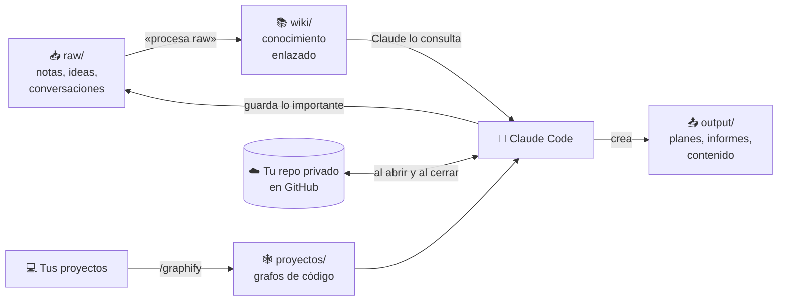

# 🧠 Segundo Cerebro

### Claude Code + Obsidian: la IA recuerda tus proyectos y no empieza de cero cada vez

**[Instalar en 5 minutos →](SETUP.md)**

---

## ✨ Qué consigues

| | |
|---|---|
| 🗂️ **Memoria entre conversaciones** | Claude consulta lo que ya sabes antes de responder y guarda lo importante al terminar. |
| 🔄 **Igual en todos tus ordenadores** | La bóveda se descarga al abrir Claude Code y se sube al cerrarlo. |
| 📜 **Aprovecha tu historial** | `/importar-historial` convierte tus conversaciones antiguas en notas útiles. |
| 🕸️ **Proyectos de código en grafo** | Graphify indexa tu código para que Claude no tenga que releerlo entero cada vez. |
| 🎬 **Ve vídeos** | `/watch-video` transcribe YouTube, Instagram, TikTok o archivos locales. |
| 🏢 **Kit de cerebro de empresa** | Matriz de permisos, fichas por persona, subagentes por área y un plan de 4 semanas. |

---

## ⚙️ Cómo funciona

| Carpeta | Para qué | Quién escribe |
|---|---|---|
| `raw/` | Bandeja de entrada, sin orden | Tú y Claude |
| `wiki/` | Una nota por concepto, enlazadas | Claude |
| `output/` | Lo que Claude produce para ti | Claude |
| `proyectos/` | Grafos de tus proyectos de código | Graphify |
| `empresa/` | Kit para montar el cerebro de IA de una empresa | Tú |

---

## 🚀 Empezar

1. Abre **[SETUP.md](SETUP.md)**, copia el prompt de tu sistema (Windows o Mac) y pégalo en Claude Code.
2. Claude te crea **tu propio repositorio privado** a partir de esta plantilla e instala todo: skills, herramientas, Obsidian y la sincronización.
3. Di **/importar-historial** para aprovechar tus conversaciones anteriores.
4. Abre Obsidian y pulsa **Ctrl+G** para ver cómo crece el grafo.

> [!NOTE]
> Esta plantilla está vacía. Tus notas van solo a **tu** repositorio privado; nadie más las ve.

---

## 🧩 Qué se instala

| Herramienta | Comando | Para qué |
|---|---|---|
| [Graphify](https://github.com/Graphify-Labs/graphify) | `/graphify <ruta>` | Grafo de conocimiento de un proyecto |
| Watch Video | `/watch-video <url>` | Transcribir y analizar vídeos |
| Find Skills | `/find-skills` | Buscar e instalar más skills |
| Importar historial | `/importar-historial` | Pasar conversaciones antiguas a notas |
| Subagentes | `procesador-raw`, `investigador` | Ordenar `raw/` y crear documentos en `output/` |

---

## 🔒 Privacidad

- Al importar, se tapan claves, tokens y contraseñas (`[CLAVE]`, `[TOKEN]`, `[OCULTO]`).
- Las conversaciones extraídas se procesan en una carpeta temporal fuera de la bóveda y nunca se suben.
- Las reglas impiden guardar contraseñas, datos bancarios o datos personales de terceros.
- ⚠️ Si lo usas en el ordenador del trabajo, revisa qué permite tu empresa sobre guardar su información en un repositorio personal.

---

Hecho con [Claude Code](https://claude.com/claude-code) · Obsidian · GitHub

