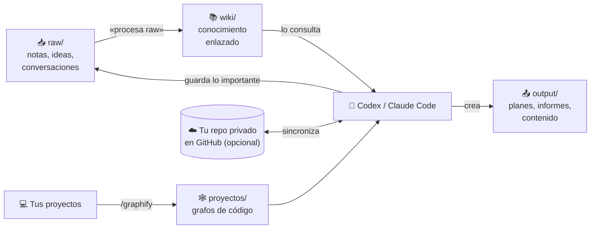

# 🧠 Segundo Cerebro

### Codex o Claude Code + Obsidian: tu IA recuerda tus proyectos y no empieza de cero cada vez

**[Instalar en 5 minutos →](SETUP.md)** · **[Ver la demo del grafo →](https://al3xbr4.github.io/segundo-cerebro-plantilla/cerebro.html)**

---

## ✨ Qué consigues

| | |
|---|---|
| 🗂️ **Memoria entre conversaciones** | Tu agente consulta lo que ya sabes antes de responder y guarda lo importante al terminar. |
| 🔄 **Igual en todos tus ordenadores** | Se sincroniza sola con tu repositorio privado (opcional; sin GitHub funciona en local). |
| ⏰ **Rutina diaria** | Actualiza los grafos, importa conversaciones nuevas y ordena las notas, sin que hagas nada. |
| 📜 **Aprovecha tu historial** | `/importar-historial` convierte tus conversaciones antiguas en notas útiles. |
| 🕸️ **Proyectos de código en grafo** | Graphify indexa tu código para que el agente no lo relea entero cada vez, con un visor interactivo. |
| 🎬 **Ve vídeos** | `/watch-video` transcribe YouTube, Instagram, TikTok o archivos locales. |
| 🏢 **Kit de cerebro de empresa** | Matriz de permisos, fichas por persona, subagentes por área y un plan de 4 semanas. |

---

## ⚙️ Cómo funciona

| Carpeta | Para qué | Quién escribe |
|---|---|---|
| `raw/` | Bandeja de entrada, sin orden | Tú y el agente |
| `wiki/` | Una nota por concepto, enlazadas | El agente |
| `output/` | Lo que el agente produce para ti | El agente |
| `proyectos/` | Grafos de tus proyectos de código | Graphify |
| `empresa/` | Kit para montar el cerebro de IA de una empresa | Tú |

---

## 🚀 Empezar

1. Abre **[SETUP.md](SETUP.md)**, copia el prompt y pégalo en **Codex** o **Claude Code** (Windows o Mac).
2. Tu agente lo instala todo: la bóveda (en local o en **tu propio repositorio privado**), las skills, Obsidian y la rutina diaria.
3. Dile **«importa mi historial»** para aprovechar tus conversaciones anteriores.
4. Abre Obsidian y pulsa **Ctrl+G** para ver cómo crece el grafo.
5. Abre **`cerebro.html`** de la bóveda con doble clic: el grafo de todo lo que sabe tu IA, con buscador y fichas. La rutina lo regenera cada día y sirve para enseñárselo a quien quieras.

> [!NOTE]
> Esta plantilla está vacía. Tus notas van solo a **tu** repositorio privado; nadie más las ve.

---

## 🧩 Qué se instala

| Herramienta | Comando | Para qué |
|---|---|---|
| [Graphify](https://github.com/Graphify-Labs/graphify) | `/graphify <ruta>` | Grafo de conocimiento de un proyecto |
| Watch Video | `/watch-video <url>` | Transcribir y analizar vídeos |
| Find Skills | `/find-skills` | Buscar e instalar más skills |
| Importar historial | «importa mi historial» | Pasar conversaciones antiguas de Codex y Claude Code a notas |
| Visor del grafo | `scripts/visor_grafo.py` | `grafo.html`: buscador, áreas, ficha de cada concepto |
| Rutina diaria | `scripts/rutina.sh` | Grafos, historial y `raw/` → `wiki/` automáticos |

---

## 🔒 Privacidad

- Al importar, se tapan claves, tokens y contraseñas (`[CLAVE]`, `[TOKEN]`, `[OCULTO]`).
- Las conversaciones extraídas se procesan en una carpeta temporal fuera de la bóveda y nunca se suben.
- Las reglas impiden guardar contraseñas, datos bancarios o datos personales de terceros.
- ⚠️ Si lo usas en el ordenador del trabajo, revisa qué permite tu empresa sobre guardar su información en un repositorio personal.

---

Funciona con Codex y Claude Code · Obsidian · GitHub

